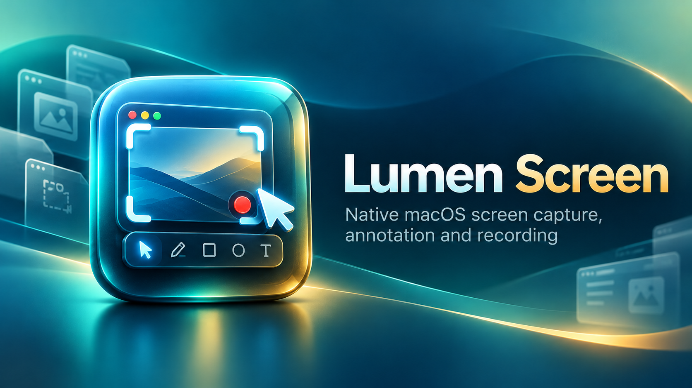

  

# Lumen Screen

Captura de tela, anotações e gravação de vídeo para macOS.

O Lumen Screen é um aplicativo nativo para macOS, desenvolvido pela **Valente Soluções**. A versão final mais recente é **1.0.0**, gratuita para uso.

## Baixar

Acesse a [Release 1.0.0](https://github.com/valentesolucoes/lumenscreen-releases/releases/tag/v1.0.0) e baixe `Lumen-Screen-1.0.0-Universal.dmg` e `Lumen-Screen-1.0.0-Universal.dmg.sha256`. Confira o checksum antes de abrir o pacote. Consulte o [guia de instalação](docs/INSTALACAO-1.0.0.md).

SHA-256 do DMG: `d24a1b4e0d9c7f6044709a95b0f46823f6d822725419adcbebede0e477d9c7c3`.

## Recursos

- Captura de tela inteira e de regiões, com pré-seleção de janelas e som de obturador.
- Capturador de Cores.
- Gravação de vídeo da tela ou de regiões e gravação de GIF por região.
- Anotações com formas, setas, caneta, destaque e texto editável.
- Adesivo para manter capturas fixadas sobre outras janelas.
- Atalhos configuráveis e acesso pela barra de menus.

## Requisitos

- macOS 15 ou superior.
- Mac Intel (x86_64) ou Apple Silicon (arm64); o DMG é Universal.
- Permissão de gravação de tela do macOS para os recursos de captura e gravação.

## Segurança do macOS

Esta versão está assinada com **Apple Development** e **não foi notarizada pela Apple**. A assinatura não representa aprovação da Apple. O macOS pode exibir um aviso ou impedir a primeira abertura. Leia o [guia de instalação e segurança](docs/INSTALACAO-1.0.0.md) e use somente os controles por aplicativo do próprio macOS. Não desative globalmente o Gatekeeper nem remova a quarentena por comando. Se o sistema indicar que o aplicativo está danificado, contém malware ou teve a assinatura revogada, não prossiga e informe os mantenedores.

## Notas da versão

Consulte as [notas da versão 1.0.0](docs/NOTAS-1.0.0.md) e o [histórico de versões](RELEASE-NOTES.md). Versões anteriores permanecem disponíveis na [lista de Releases](https://github.com/valentesolucoes/lumenscreen-releases/releases).

**Desenvolvido por Valente Soluções** · [www.valentesolucoes.com.br](https://www.valentesolucoes.com.br)
